<picture>
  <source media="(prefers-color-scheme: dark)" srcset="./assets/header-dark.svg">
  
</picture>

 

Desenvolvedor full stack com mais de dois anos entregando software em produção. Trabalho de ponta a ponta: entendo o problema com quem vai usar o sistema, construo front-end e back-end, integro IA onde ela resolve algo de verdade e cuido do deploy.

Escolho a linguagem pelo projeto, não o contrário. No dia a dia alterno entre Python, TypeScript, C# e Node.js.

## Áreas de atuação

| Área | O que entrego |
| :-- | :-- |
| **Sistemas sob medida** | Aplicações web para clientes, do levantamento de requisitos à entrada em produção |
| **Ferramentas internas** | Automação de rotinas e sistemas de apoio para equipes |
| **IA e automação** | Integração de LLMs a produtos e a processos de negócio |
| **Infraestrutura e deploy** | Ambientes em Docker, pipelines de CI/CD e operação em produção |

## Como trabalho

<picture>
  <source media="(prefers-color-scheme: dark)" srcset="./assets/fluxo-dark.svg">
  
</picture>

## Stack

| Camada | Tecnologias |
| :-- | :-- |
| **Back-end** | `Python` `Django` `Django REST Framework` `Flask` `C#` `.NET` `Node.js` `Express` |
| **Front-end** | `TypeScript` `React` `Vite` `JavaScript` `Blazor` `HTML` `CSS / SCSS` |
| **IA** | `Integração com LLMs` `Gemini API` |
| **Infraestrutura** | `Docker` `Docker Compose` `GitHub Actions` `nginx` `Railway` |
| **Qualidade** | `pytest` `testes unitários e de segurança` |

## Projetos abertos

A maior parte do meu trabalho está em repositórios privados de clientes. Os projetos abaixo são públicos e mostram como organizo código, testes e deploy.

| Projeto | Descrição | Tecnologias |
| :-- | :-- | :-- |
| [**sistema_base**](https://github.com/Dhrds/sistema_base) | Template que uso como ponto de partida de sistemas novos, com front em React 19 e servidor Express | `TypeScript` `React` `Vite` `Express` |
| [**projeto_votacao**](https://github.com/Dhrds/projeto_votacao) | Aplicação de votação com foco na suíte de testes unitários e de segurança | `Django` `DRF` `pytest` `GitHub Actions` |
| [**my-django-app**](https://github.com/Dhrds/my-django-app) | Gerador que cria a estrutura de um projeto Django com Docker, nginx e CI | `Python` `Docker` |
| [**rpg**](https://github.com/Dhrds/rpg) | Aplicação Django com ambiente em Docker Compose e pipeline de CI/CD | `Django` `Docker` `GitHub Actions` |

<!--
  CONTATO: descomente e preencha com os seus links.

## Contato

[LinkedIn](https://www.linkedin.com/in/SEU-USUARIO) · [E-mail](mailto:SEU-EMAIL)
-->
