  

 

**Olá, viajante.** Eu sou o Douglas, desenvolvedor full stack.

Há mais de dois anos entrego software em produção: sistemas sob medida para clientes, ferramentas internas que poupam horas do time, automações com IA e a infraestrutura que mantém tudo no ar. Para mim, linguagem é equipamento, e eu troco conforme a missão. No dia a dia passo por Python, TypeScript, C# e Node.js.

A maior parte do que construo vive em repositórios privados. O mapa abaixo mostra o caminho que uma entrega costuma percorrer nas minhas mãos.

 

  

## Especialidades

| | Missão | Como eu jogo |
| :-: | :-- | :-- |
| 🧭 | **Sistemas sob medida** | Do briefing com o cliente até o sistema em uso, cuidando de front, back e banco |
| 🛠️ | **Ferramentas internas** | Automatizo o trabalho repetitivo para o time gastar tempo com o que importa |
| ✨ | **IA e automação** | Coloco LLMs dentro do produto, como parte do fluxo e não como enfeite |
| 🚢 | **Infra e deploy** | Docker, pipelines de CI/CD e o sistema rodando em produção |

## Inventário

| Slot | Equipado |
| :-- | :-- |
| **Back-end** | `Python` `Django` `Django REST Framework` `Flask` `C#` `.NET` `Node.js` `Express` |
| **Front-end** | `TypeScript` `React` `Vite` `JavaScript` `Blazor` `HTML` `CSS / SCSS` |
| **IA** | `Integração com LLMs` `Gemini API` |
| **Infra** | `Docker` `Docker Compose` `GitHub Actions` `nginx` `Railway` |
| **Qualidade** | `pytest` `testes unitários e de segurança` |

## Amostras abertas

O trabalho de cliente fica guardado. Estes são públicos e mostram como eu organizo um projeto.

| Projeto | O que é | Itens usados |
| :-- | :-- | :-- |
| [**sistema_base**](https://github.com/Dhrds/sistema_base) | Template que uso como ponto de partida de sistemas novos, com front em React 19 e servidor Express | `TypeScript` `React` `Vite` `Express` |
| [**projeto_votacao**](https://github.com/Dhrds/projeto_votacao) | Aplicação de votação em que o foco é a suíte de testes unitários e de segurança | `Django` `DRF` `pytest` `GitHub Actions` |
| [**my-django-app**](https://github.com/Dhrds/my-django-app) | Script que monta sozinho a estrutura de um projeto Django com Docker, nginx e CI | `Python` `Docker` |
| [**rpg**](https://github.com/Dhrds/rpg) | Jogo de RPG para a web, com ambiente em Docker Compose e pipeline de CI/CD | `Django` `Docker` `GitHub Actions` |

<!--
  CONTATO: descomente e preencha com os seus links.

## Chamar para a party

[LinkedIn](https://www.linkedin.com/in/SEU-USUARIO) · [E-mail](mailto:SEU-EMAIL)
-->

 

  Jogo salvo. Até a próxima fase.

